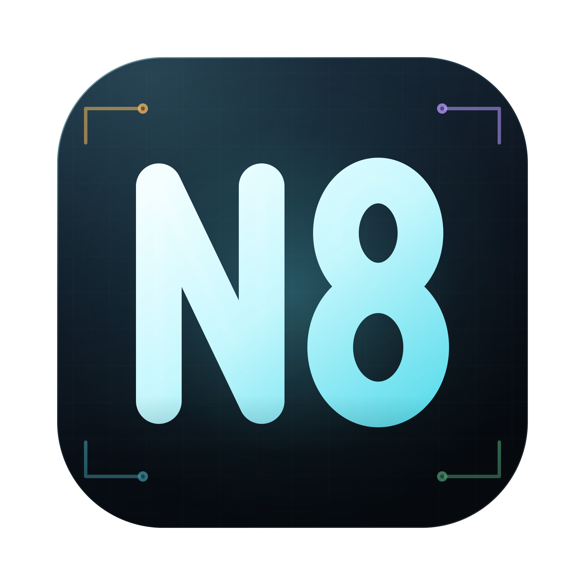
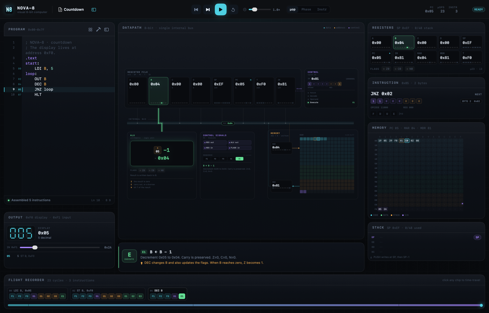
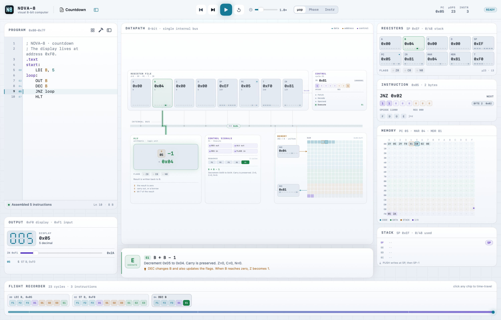

# NOVA-8



**A visual 8-bit computer for macOS.** Registers, a real assembler, a 256-byte memory map, and every fetch, decode and execute cycle animated on a single internal bus.

| Dark theme | Light theme |
|:---:|:---:|
|  |  |

NOVA-8 is a teaching machine, not an emulator of anything. It has a deliberately small instruction set, a single bus, and one visible transfer per clock. Every micro-operation explains itself in plain English while the datapath lights up. It follows the system appearance, so it is equally at home in light and dark mode.

---

## Run it

Requirements: macOS 15 or later, Xcode 16 or later, and [XcodeGen](https://github.com/yonaskolb/XcodeGen) (`brew install xcodegen`).

```sh
git clone https://github.com/xeronith/nova8.git
cd nova8
xcodegen generate
open Nova8.xcodeproj
```

Choose the **Nova8** scheme and press Run. The repository root is the folder containing `project.yml`; `Nova8/` inside it is the app source, not the checkout directory. The Xcode project is generated, so adding or removing files only requires re-running `xcodegen generate`.

To update an existing checkout, `git pull` and re-run `xcodegen generate` before building.

Command line build and tests, also from the repository root:

```sh
xcodebuild -scheme Nova8 -destination 'platform=macOS' build
xcodebuild -scheme Nova8 -destination 'platform=macOS' test
```

---

## The machine

- 8-bit data, 8-bit address space, **256 bytes of unified memory**
- A single internal bus. One value moves per micro-operation
- Accumulator **A**, general registers **B C D**, stack pointer **SP**
- **PC**, **IR**, **MAR**, **MDR**, and operand latch **T**
- **Z** (zero), **C** (carry/borrow), **N** (negative) flags
- 29 opcodes, 1–2 byte instructions
- Stack, subroutines, absolute and register-indirect addressing
- Memory-mapped display and input ports

### Memory map

| Range | Size | Region |
|---|---|---|
| `0x00–0x7F` | 128 B | Program |
| `0x80–0xBF` | 64 B | Data |
| `0xC0–0xEF` | 48 B | Stack (SP starts at `0xEF`, grows down) |
| `0xF0` | 1 B | Display output |
| `0xF1` | 1 B | Input switches |
| `0xF2–0xFF` | — | Reserved I/O |

`OUT r` is assembler sugar for `ST r, 0xF0`; `IN r` is `LD r, 0xF1`. The display really is just a memory write, and the memory grid pulses when it happens.

### Instruction encoding

The first byte is split into a **5-bit opcode** and a **3-bit register field** (0=A, 1=B, 2=C, 3=D, 4=SP). The decode panel shows this split live.

```
  00110 000
  opcode  reg
```

Instructions with an operand are two bytes. The second byte is an immediate, an absolute address, or a register selector.

### Instruction set

| Mnemonic | Bytes | Effect |
|---|---|---|
| `NOP`, `HLT` | 1 | no operation / stop the clock |
| `LDI r, imm` | 2 | `r ← imm` |
| `LD r, addr` | 2 | `r ← mem[addr]` |
| `ST r, addr` | 2 | `mem[addr] ← r` |
| `LDR r, ptr` | 2 | `r ← mem[ptr]` |
| `STR r, ptr` | 2 | `mem[ptr] ← r` |
| `MOV rd, rs` | 2 | `rd ← rs` |
| `ADD r` | 1 | `A ← A + r`, flags |
| `SUB r` | 1 | `A ← A − r`, flags |
| `AND r`, `OR r`, `XOR r` | 1 | `A ← A op r`, flags |
| `CMP r` | 1 | flags from `A − r`, no writeback |
| `INC r`, `DEC r` | 1 | `r ← r ± 1`, flags (carry preserved) |
| `NOT r` | 1 | `r ← ~r`, flags |
| `SHL`, `SHR` | 1 | shift A, old bit into carry |
| `ADDI imm` | 2 | `A ← A + imm`, flags |
| `PUSH r`, `POP r` | 1 | stack push/pop |
| `JMP`, `JZ`, `JNZ`, `JC`, `JNC addr` | 2 | jumps |
| `CALL addr`, `RET` | 2 / 1 | subroutine call/return |
| `OUT r`, `IN r` | alias | `ST r, 0xF0` / `LD r, 0xF1` |

ALU operations use **A** as the accumulator. `CMP` is a subtraction that only updates flags. Loads and moves do not change flags. The assembler also accepts `DISPLAY`, `INPUT`, `PROGRAM_START` and `DATA_START` as predefined symbols.

### What a cycle looks like

`LD B, count` becomes ten micro-operations:

```
FETCH    F1  MAR ← PC                PC → address bus
         F2  MDR ← MEM[MAR]          memory read
         F3  IR ← MDR · PC++         instruction latched
DECODE   D1  decode                  5-bit opcode + 3-bit register
OPERAND  O1  MAR ← PC
         O2  MDR ← MEM[MAR]
         O3  T ← MDR · PC++          address held in T
EXECUTE  E1  MAR ← T
         E2  MDR ← MEM[MAR]          read count
         E3  B ← MDR
```

The datapath animates each transfer as a packet along the bus, the control signals assert, the ALU glows, and the register values change. The flight recorder keeps a snapshot of every cycle, so you can scrub backwards and then step forward again from any point.

---

## Programming it

The editor is a real two-pass assembler. `.text` starts at `0x00`, `.data` at `0x80`. Labels, constants, `DB`, comments, and hex/decimal/binary/character/string literals are supported.

```asm
; Sum 1..10, then show 55
.text
start:
    LDI A, 0        ; running total
    LDI B, 10       ; counter
loop:
    ADD B
    DEC B
    JNZ loop
    OUT A
    HLT
```

Press **⌘B** to assemble, **⌘]** to step one micro-operation, **⌘↩** to run, and **⌘R** to reset. Click a line in the gutter to set a breakpoint; run or step to hit it. The **Step** segmented control switches between micro-op, phase, and whole-instruction stepping. A **phase** or **instruction** step still records every underlying cycle in the flight recorder.

### Guided demos

Open the grid icon in the program header (or the program menu) for annotated programs:

- **Countdown** — output, flags, and a loop
- **Sum 1…10** — accumulator, flags, and branches
- **Multiply** — repeated addition
- **Fibonacci** — register shuffling
- **Block Copy** — pointers and the data region
- **Subroutine** — CALL/RET and the stack
- **Input Echo** — live memory-mapped input
- **Empty Program** — a sandbox

Each demo carries notes that appear in the narration bar as you step.

---

## The interface

- **Program** — syntax-colored editor, address gutter, breakpoints, current-line highlight, inline diagnostics
- **Datapath** — register file, ALU, control unit, memory, and the internal bus. Data packets travel the actual route of each transfer
- **Registers / Instruction / Memory / Stack** — the right rail shows every value, the decoded bit fields, all 256 memory cells with PC/MAR/SP markers, and the top of the stack
- **Output** — a 7-segment display for `0xF0`, a log of writes, and a live input slider for `0xF1`
- **Flight recorder** — one chip per micro-operation, grouped by instruction. Click a chip, or drag the scrubber underneath, to time-travel
- **Narration** — what just happened, which control lines were asserted, and a note from the current demo
- **Appearance** — the light and dark themes follow the system appearance automatically

### Shortcuts

| Action | Shortcut |
|---|---|
| Assemble & reload | `⌘B` |
| Run / pause | `⌘↩` |
| Step one micro-operation | `⌘]` |
| Step back | `⌘[` |
| Run to cursor | `⇧⌘↩` |
| Reset machine | `⌘R` |
| New / open / save as | `⌘N` / `⌘O` / `⌘S` |
| Export hex image | `⇧⌘E` |

---

## Project layout

```
Nova8/
  project.yml                     xcodegen project definition
  Nova8/
    App/                          SwiftUI app entry and SimulatorModel
    Engine/                       pure Swift, UI-free
      ISA.swift                   registers, opcodes, decoder, memory map
      CPUState.swift              architectural state and ALU
      MicroOp.swift               micro-ops, stages, control signals
      InstructionPlanner.swift    instruction → micro-op sequence
      Machine.swift               clock and snapshots
      History.swift               flight recorder
      Assembler.swift             two-pass assembler and diagnostics
      Format.swift, Samples.swift
    UI/
      Datapath/                   geometry, routes, animated datapath
      Panels/                     registers, instruction, memory, stack, output
      Editor/                     NSTextView editor, gutter, highlighter
      Theme.swift, TopBar.swift, TimelineBar.swift, ...
    Resources/Assets.xcassets     app icon
  Nova8Tests/                     assembler, execution, micro-op, model, snapshots
  Docs/                           screenshot and icon source
```

The engine has no SwiftUI dependency, so the assembler and CPU are exercised directly by the test suite. The UI is a thin observer of `SimulatorModel`.

## Tests

The test suite covers:

- instruction encoding, labels, data sections, strings, diagnostics
- real programs: sum, multiply, Fibonacci, block copy, subroutines, flags, I/O
- micro-op traces and phase grouping
- history restore/fork and time travel
- run loop, breakpoints, halted state, output scrubbing
- offscreen render smoke tests for the main window, stack state, halt, errors, and demo sheet

All tests pass with `xcodebuild test`.

## Notes

- The machine has no interrupts, no pipelining, and no self-modifying execution; every instruction is planned before it runs.
- The stack pointer starts at `0xEF` and grows downward. `PUSH` writes at SP and then decrements; `POP` increments first and then reads.
- The autosaved buffer lives at `~/Library/Application Support/Nova8/last.asm`.
- The app is intentionally not sandboxed so file open/save and the local autosave work without extra prompts.

## License

NOVA-8 is released under the [MIT License](LICENSE).
